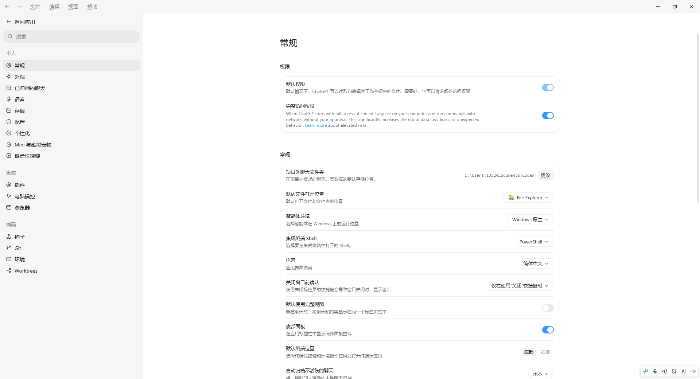
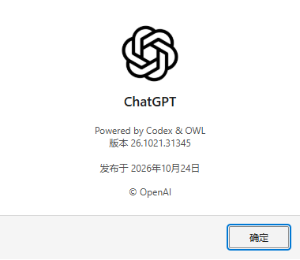
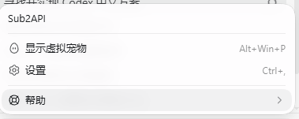
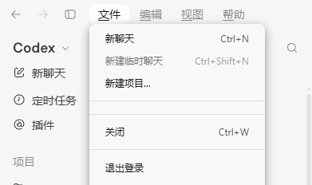

# Codex 中文助手

一个用于 Windows Codex 桌面版的中文界面工具。读取当前版本内置词典，生成独立汉化副本，更新后可再次执行。原版安装文件保留。

## 汉化效果

以下四张截图由使用者提供，来自 `ChatGPT / Powered by Codex & OWL 26.1021.31345`，对应本机安装包 `26.1021.3705.0`。部分词条仍可能保留英文，截图不代表百分之百翻译覆盖。



| 版本信息 | 应用菜单 | 文件菜单 |
| --- | --- | --- |
|  |  |  |

## 使用

需要 Windows、Python 3.11 或以上（包含 tkinter）和 Node.js 22 或以上。生成副本需要足够磁盘空间，大小约为一份 Codex 安装目录。

1. 下载仓库 ZIP 并完整解压，或克隆仓库。
2. 双击 `打开中文助手.cmd`，也可运行 `python -m codex_zh_helper`。
3. 检测原版安装位置，点击 **生成汉化副本**。
4. 保存工作，点击 **启动汉化版**。

切换时会结束对应版本的界面进程，正在进行的任务可能中断。工具按完整程序路径定位进程，不按名称全局结束其他 ChatGPT 或 Chrome。遇到退出中的进程会重新检查状态，持续权限不足则停止并提示原因。

原版更新后，重新检测并生成副本。格式不兼容时工具会停止；无法保证所有未来版本都无需适配。点击 **返回原版** 可结束副本并请求启动保留的原版。

`launch-localized.cmd` 和 `launch-original.cmd` 分别提供直接切换入口。

## 工作原理

- 从当前程序的 `app.asar` 读取随版本发布的简体中文词典。
- 按消息 ID 替换界面脚本中的英文默认文本，保留变量和富文本标签。
- 跳过动态插值、缺失翻译、占位符不匹配的消息，不修改聊天内容或内部功能开关。
- 在用户目录生成独立副本，重建归档偏移与校验值，并同步副本启动器中的对应资源校验值。
- 校验修改后 JavaScript 语法、归档内容和未修改文件，再记录可用副本。
- 识别 Store 激活跳板，直接启动副本中的实际界面程序，并检查进程是否持续运行。

副本的启动器校验值会变化，因此不再保持原文件的数字签名状态；原版不变。工具不分发 Codex 程序或官方词典，仅在本机处理已安装文件。

## 数据与恢复

运行记录、配置备份和日志位于 `~/.codex/zh-cn-helper`；生成的副本位于 `~/.codex/zh-cn-ui`。设置了 `CODEX_HOME` 时使用该目录。

工具自动识别旧版本已经生成的副本。源码目录中不保存个人路径、启动记录、聊天记录或配置备份。日志仅保存在本机；分享日志前请自行检查其中的个人信息。

手动恢复也可完全退出副本后，从 Windows 开始菜单打开原版。语言偏好仅设置为 `zh-CN`，修改前保存完整配置备份。

## 开发与验证

项目仅依赖 Python 标准库。生成翻译时使用本机 Node.js 校验 JavaScript 语法。

```powershell
python -m unittest discover -s tests -v
python -m compileall -q codex_zh_helper tests
```

代码按界面、任务流程、设置、归档翻译、进程切换和本地存储拆分。测试覆盖翻译匹配、插值保护、归档重建、启动器识别、退出竞态和界面状态。

已在 Codex `26.1021.3705.0` 的资源包上验证翻译与归档处理。原生外壳、插件界面、远端内容、词典缺失及不兼容消息仍可能保留英文；程序运行检查不等于所有界面已通过人工验收。

关于其他汉化项目及最新版本兼容性，见 [同类项目与兼容范围](docs/alternatives.md)。本工具面向该 Codex / OWL 桌面程序，不等于已经支持所有独立 ChatGPT 桌面客户端。

## 参考

- [xqnode/codex-zh-CN](https://github.com/xqnode/codex-zh-CN)：Windows 桌面资源补丁思路。
- [LinYiXin123/claude-code-zh-toolkit](https://github.com/LinYiXin123/claude-code-zh-toolkit)：便携版中文增强思路。

此项目为独立社区工具，与 OpenAI 无隶属关系。
